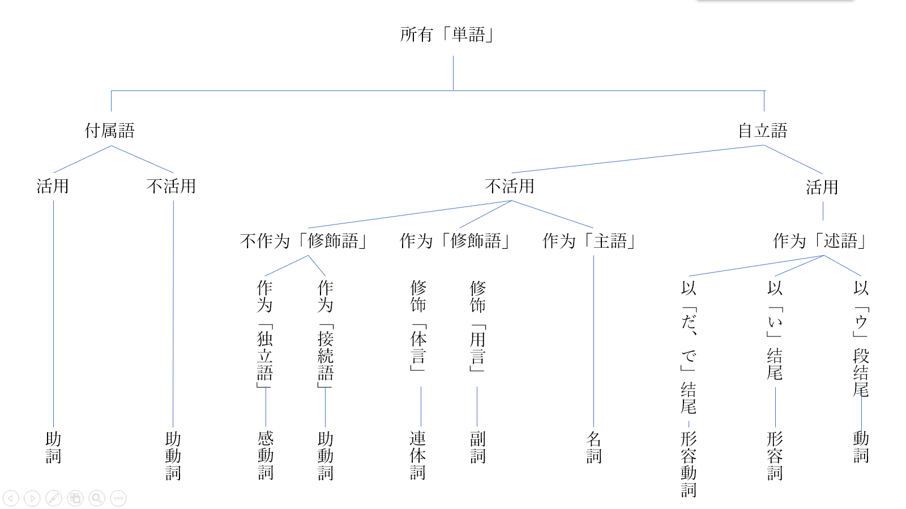

# 「品词」的种类

在「文節」的基础上最小单位再往下细分，可以将「単語」分为「自立語」・「付属語」・「活用がある（可活用）」・「活用がない（不活用）」等根据语法将「単語」分类的情况，叫做「品詞[^1]」。

> #### 自立语和附属语
>
> * 自立语，是仅靠词语本身而不受其他词语或句子影响本身意思的词语。**可以单独的作为一个句子成分，在「文節」中，一定只作为开头。** 
> * 附属语，是后接自立语后面的词语。**词语本身没有任何意义，不能作为一个单独的句子成分。**

## 品詞分類表 

日本语的品词，分作名词、动词、形容词等十个种类。

## 日本语的「品詞」一览 

### 動詞 

动词，是表达事物、作用、存在等行为的词语。**自立语中可活用变化的词语是「用言」**，终止形用「う」段是动词的特征。

> 文字を**書く**。\
> **写**字。\
> \
> トイレを**掃除する**。\
> **打扫**厕所。

### 形容詞 

形容词，用于详细地说明事物的性质或状态。终止形用「い」是形容词的特征。

> **面白い**女。\
> **有趣的**女人。
>
> あの声は何とか**怖い**だよ。\
> 那个声音总觉得很**恐怖**。

### 形容動詞 

形容动词，用于详细地说明事物的性质或状态。终止形用「だ」是形容动词的特征。

> 花が**綺麗だ**。\
> **漂亮的**花。
>
> 部屋はとても**静かだ**。\
> 房间非常的**安静**。

### 名詞 

名词，用于表达事物的名称。**也叫做「体言」**，特征是不依靠其他词语的情况下可以单独作为主语。

> **浴衣**\
> **和服**
>
> **鉛筆**\
> **铅笔**

### 副詞 

副词，用于详细说明「用言」的词语。主要连用于动词、形容词做「修飾語」。

> **ゆっくり**話して下さい。\
> 请**慢慢地**说。
>
> 天気が**段々**寒くなる。\
> 天气**渐渐**变得寒冷。

### 連体詞 

连体词，用于详细说明「体言」的词语。主要连用于名词做「修飾語」。

> **この**人は可笑しい。\
> **这个**人很可疑。
>
> **あの**本は椎名さんの本ですか。\
> **那**本书是椎名同学的书吗？

### 接続詞 

接续词，用于连接句子或上下文的关系。

> 「それで」「だから」「しかし」「だが」「また」「そして」「それとも」「または」「つまり」「なぜなら」「ところで」「さて」\
> 因此、因为、不过、但是、再、接着、尽管如此、再者、也就是说、原因是、话说、那么

### 感動詞 

感动词，是表示感叹、应答、呼叫等场合的词语。一般的，感动词的特征是用于句首。

> 「あら」「ああ」「こんにちは」「さようなら」\
> 哎呀、w(ﾟДﾟ)w、你好、再见

### 助詞 

助词，不更改句子的内容，用于提示其他词语之间的关系。不活用，也不能独立使用。

> 「を」「に」「が」「は」「と」「ても」「ば」「も」「こそ」\
> 把、在|于、是|存在、是|拥有、和|引用、即使|极限、如果、也、才

### 助動詞 

助动词，是附属于用言和体言后赋予含义的词语。助动词是可活用的附属语。

> 「れる」「られる」「せる」「させる」「ない」「そうだ」「らしい」「です」\
> 被（五段活用）、被（一段活用）、使|让（五段活用）、使|让（一段活用）、不、听说、好像、是（判断句结尾）

以上是十种品词。

接下来您将会简单地了解敬语。

[^1]: ひんし

    文法上の職能によって類別した単語の区分け。

    国文法ではふつう、名詞・代名詞・動詞・形容詞・形容動詞・連体詞・副詞・接続詞・感動詞・助動詞・助詞の11品詞に分類する。
